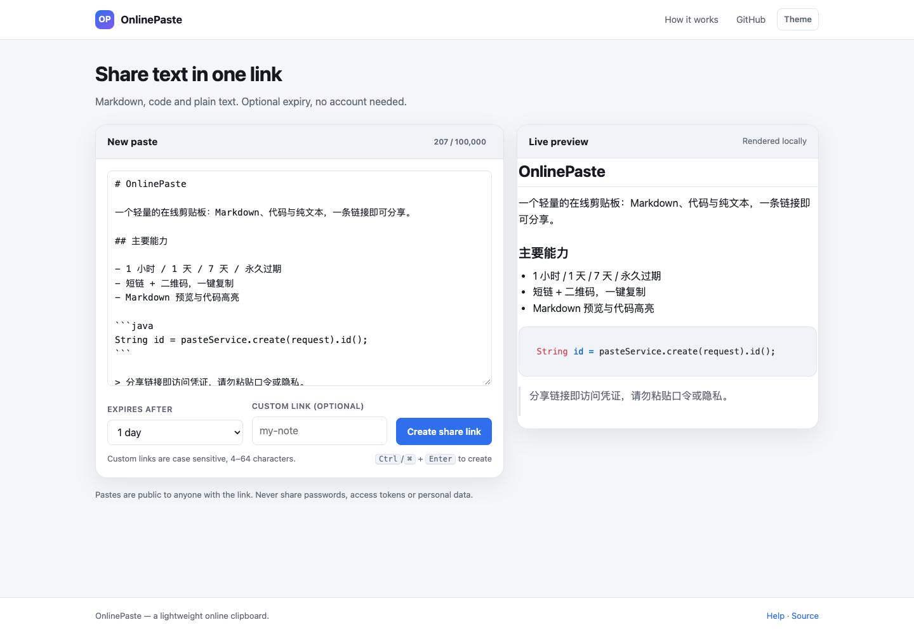
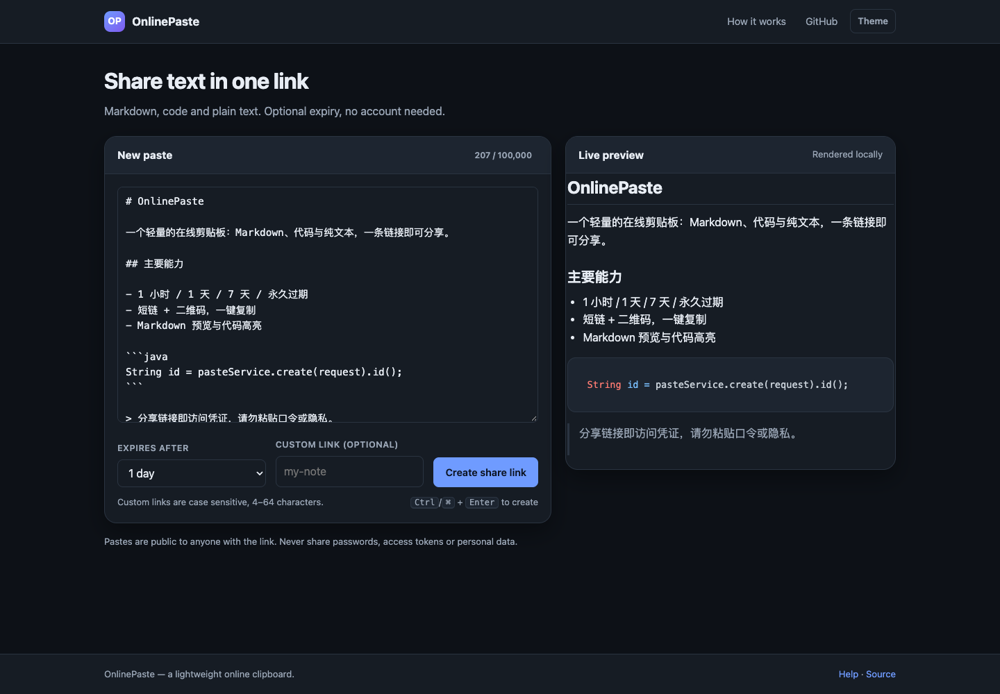
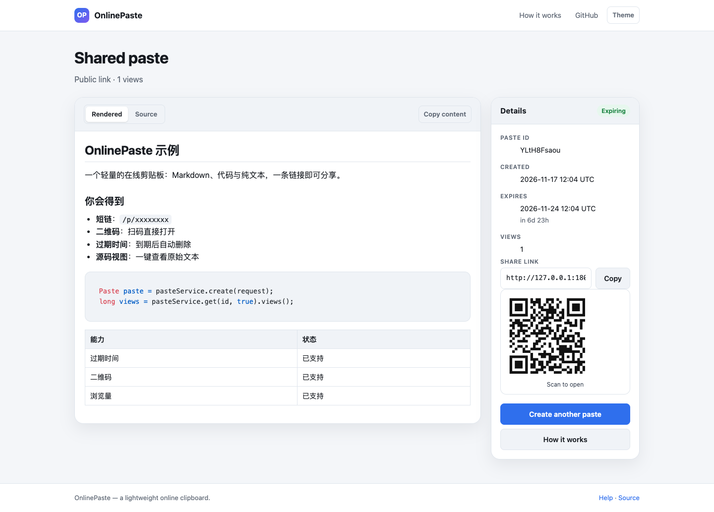
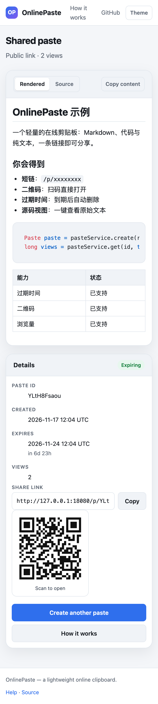

# OnlinePaste

基于 Spring Boot 3.3 + Redis 的轻量在线剪贴板：粘贴文本、Markdown 或代码，生成可选过期时间的短链与二维码。

<p align="center">
  <a href="./LICENSE"></a>
  <a href="./.github/workflows/ci.yml"></a>
  
  
</p>

> **Demo（第三方部署，非本仓库维护）：<https://p.myyrh.com>**
> 可能运行旧版本。2026-11-17 核对时 HTTPS 握手失败、HTTP 返回 502，当前不可访问，可用性不作保证。

## 目录

- [特性](#特性)
- [界面截图](#界面截图)
- [快速开始](#快速开始)
- [配置说明](#配置说明)
- [架构与目录](#架构与目录)
- [API 文档](#api-文档)
- [安全说明](#安全说明)
- [测试与 CI](#测试与-ci)
- [FAQ](#faq)
- [贡献与许可](#贡献与许可)
- [English](#english)

## 特性

### 功能

- **可选过期时间**：`1h` / `1d` / `7d` / `never` 四档，Redis TTL 到期自动删除，不需要清理任务。
- **短链与二维码**：每次创建得到随机短链，查看页和结果卡片直接展示可扫描的 SVG 二维码。
- **Markdown 与代码**：围栏代码块使用 highlight.js 高亮；查看页提供「Rendered / Source」切换，整篇代码也能自动识别语言。
- **自定义短链**：可指定 4–64 位字母、数字、`-`、`_`，便于分享 `release-notes` 这类易读地址。
- **访问统计**：每次读取或打开查看页，Redis 中的浏览计数 +1，并随粘贴一起过期。
- **服务端渲染**：Thymeleaf 页面无需前端构建，部署只有一个 Spring Boot 进程和一个 Redis。

### 安全

- **口令不落库**：Redis 密码、端口、公网地址等全部通过环境变量注入，`application.yml` 只有 `${ENV:default}` 占位。
- **输出严格转义**：动态内容一律走 `th:text`，全仓库没有 `th:utext`；Markdown 在浏览器本地渲染时会转义原始 HTML 并过滤危险链接协议。
- **CSP 与安全响应头**：默认禁止内联脚本、禁止被 iframe 嵌套，并关闭 MIME 嗅探。
- **限流与长度上限**：写接口按 IP 固定窗口限流，内容长度、ID 格式均有服务端校验。
- **容器最小权限**：运行时用 `adduser` 创建独立用户并以 `USER app` 启动，Redis 默认不暴露到宿主机端口。

### 体验

- **亮色 / 暗色主题**：跟随系统偏好，也可以手动切换，选择保存在 localStorage。
- **移动端适配**：900px 以下自动单列，表单与查看页在手机宽度下可直接操作。
- **复制反馈**：分享链接、短 ID、粘贴内容都有复制按钮，成功后按钮与 toast 同时反馈。
- **实时预览**：创建页边输入边渲染 Markdown，`Ctrl/⌘ + Enter` 直接提交。
- **无账号**：打开即用；分享链接本身就是访问凭证。

## 界面截图

| 新建页（亮色） | 新建页（暗色） |
| --- | --- |
|  |  |



<p align="center">
  
</p>

## 快速开始

### Docker Compose（推荐，包含 Redis）

在仓库根目录执行：

```bash
cp .env.example .env
# 编辑 .env：至少设置 REDIS_PASSWORD（可用 openssl rand -base64 32 生成）
docker compose up -d --build
```

启动后访问 <http://localhost:8080>。Compose 会先等 Redis healthy，再启动应用；两个容器都带 healthcheck。

`ONLINEPASTE_BASE_URL` 决定分享链接和二维码里的公网地址，部署到域名后务必修改。Redis 默认只在 Compose 内网可达，不映射宿主机端口。

### 本地开发

需要 JDK 17、Maven 3.8+（或直接使用 `mvnw`）以及 Redis 6+。

```bash
docker run -d --rm --name onlinepaste-redis -p 127.0.0.1:6379:6379 \
  redis:7.2-alpine redis-server --requirepass dev-password --appendonly no

export REDIS_HOST=127.0.0.1
export REDIS_PORT=6379
export REDIS_PASSWORD=dev-password

./mvnw spring-boot:run
```

`ONLINEPASTE_BASE_URL` 默认是 `http://localhost:8080`，本地开发通常无需修改。模板热更新可加 `THYMELEAF_CACHE=false`。

## 配置说明

所有配置都可以用环境变量覆盖，默认值写在 `src/main/resources/application.yml`。

| 环境变量 | 默认值 | 说明 |
| --- | --- | --- |
| `SERVER_PORT` | `8080` | 应用 HTTP 端口 |
| `REDIS_HOST` | `127.0.0.1` | Redis 地址；Compose 内为 `redis` |
| `REDIS_PORT` | `6379` | Redis 端口 |
| `REDIS_DATABASE` | `0` | Redis 逻辑库编号 |
| `REDIS_PASSWORD` | 空 | Redis 口令；Compose 中为必填 |
| `REDIS_CONNECT_TIMEOUT` | `5s` | Redis 连接超时 |
| `REDIS_TIMEOUT` | `2s` | Redis 命令超时 |
| `ONLINEPASTE_BASE_URL` | `http://localhost:8080` | 分享链接与二维码使用的公网前缀；末尾多余的 `/` 会自动去掉 |
| `ONLINEPASTE_MAX_CONTENT_LENGTH` | `100000` | 单个粘贴的最大字符数；Bean Validation 另有 200000 的硬上限 |
| `ONLINEPASTE_ID_LENGTH` | `10` | 自动生成的短 ID 长度，范围 6–64 |
| `ONLINEPASTE_VIEW_COUNT_ENABLED` | `true` | 是否统计浏览量 |
| `ONLINEPASTE_RATE_LIMIT_ENABLED` | `true` | 是否启用写接口限流 |
| `ONLINEPASTE_RATE_LIMIT_PER_MINUTE` | `30` | 每个客户端 IP 每分钟允许的 POST 次数 |
| `THYMELEAF_CACHE` | `true` | 模板缓存，本地开发可设为 `false` |
| `APP_PORT` | `8080` | 仅 Compose：映射到宿主机的端口 |
| `TZ` | `UTC` | 仅 Compose：容器时区 |
| `JAVA_OPTS` | `-XX:MaxRAMPercentage=75.0 -XX:+ExitOnOutOfMemoryError` | 仅 Docker：JVM 参数 |

补充说明：

- **过期档位固定**为 `1h` / `1d` / `7d` / `never`，代码中没有自定义秒级 TTL 的环境变量；`7d` 是最长的限时档位，`never` 表示永久。
- **主题默认值跟随系统**（`prefers-color-scheme`），没有服务端配置项；手动切换后写入浏览器 localStorage。
- `ONLINEPASTE_ID_LENGTH` 超出 6–64 会导致配置校验失败，应用拒绝启动。

## 架构与目录

```mermaid
flowchart LR
    U[浏览器] -->|GET / 或 /p/{id}| P[PageController]
    P -->|读取 + 计数| S[PasteServiceImpl]
    U -->|POST /api/pastes| A[PasteApiController]
    A -->|创建 / 读取| S
    S -->|SETNX + TTL / GET / INCR| R[(Redis)]
    S --> Q[QrCodeService]
    A -->|/qr.svg| Q
    L[RateLimitInterceptor] -.->|限制 POST| A
    F[SecurityHeadersFilter] -.->|CSP 等响应头| U
```

关键类职责：

| 类 | 职责 |
| --- | --- |
| `PageController` | `/`、`/help`、`/p/{id}` 页面渲染；只把转义后的内容交给模板 |
| `PasteApiController` | `/api/pastes` 的创建、读取与二维码接口 |
| `PasteServiceImpl` | 校验内容/ID、选择过期档位、生成短 ID、组装分享 URL |
| `PasteStore` / `RedisPasteStore` | 存储边界；Redis 实现用 JSON + TTL，测试使用内存实现 |
| `QrCodeService` | 用 ZXing core 把分享 URL 渲染成 SVG，无 AWT/图片编码依赖 |
| `OnlinePasteProperties` | 绑定并校验所有 `onlinepaste.*` 配置 |
| `RateLimitInterceptor` | 对 `POST /api/**` 做按 IP 的固定窗口限流 |
| `SecurityHeadersFilter` | 注入 CSP、`X-Frame-Options`、`X-Content-Type-Options` 等头 |
| `PasteApiExceptionHandler` | 把校验/冲突/存储异常转换成统一 JSON 错误 |

目录结构：

```text
.
├── src/main/java/com/onlinepaste
│   ├── config/        # 配置属性、MVC 拦截器注册
│   ├── controller/    # 页面与 JSON API
│   ├── domain/        # Paste 记录、过期档位
│   ├── service/       # 业务逻辑、Redis 存储、二维码
│   └── web/           # DTO、异常处理、限流、安全响应头
├── src/main/resources
│   ├── templates/     # index / view / help / not-found / error / fragments
│   └── static/assets/ # CSS、JS、favicon
├── src/test/java      # MockMvc + 内存 PasteStore，无外部依赖
├── docs/screenshots/  # README 截图
├── .github/workflows/ci.yml
├── Dockerfile         # 多阶段构建，非 root 运行
├── docker-compose.yaml
└── .env.example
```

## API 文档

所有 JSON 接口出错时统一返回：

```json
{ "error": "validation_error", "message": "content must not be blank" }
```

### 创建粘贴

`POST /api/pastes`，`Content-Type: application/json`

```bash
curl -sS -X POST http://localhost:8080/api/pastes \
  -H 'Content-Type: application/json' \
  -d '{"content":"# 标题\n\n第一行\n第二行","expiration":"1d","id":"my-note"}'
```

| 字段 | 必填 | 说明 |
| --- | --- | --- |
| `content` | 是 | 粘贴内容，不能全为空白；上限由 `ONLINEPASTE_MAX_CONTENT_LENGTH` 控制 |
| `expiration` | 否 | `1h` / `1d` / `7d` / `never`，省略时默认 `1d` |
| `id` | 否 | 自定义短链，4–64 位 `A-Z a-z 0-9 - _`；不能是 `api`、`p`、`help` 等保留字 |

成功返回 `201 Created`：

```json
{
  "id": "my-note",
  "url": "http://localhost:8080/p/my-note",
  "qrUrl": "/api/pastes/my-note/qr.svg",
  "createdAt": "2026-11-17T12:00:00Z",
  "expiresAt": "2026-11-18T12:00:00Z",
  "permanent": false
}
```

### 读取粘贴

`GET /api/pastes/{id}`

```bash
curl -sS http://localhost:8080/api/pastes/my-note
```

```json
{
  "id": "my-note",
  "content": "# 标题\n\n第一行\n第二行",
  "createdAt": "2026-11-17T12:00:00Z",
  "expiresAt": "2026-11-18T12:00:00Z",
  "permanent": false,
  "views": 1
}
```

每次读取都会把 `views` +1（可通过 `ONLINEPASTE_VIEW_COUNT_ENABLED` 关闭）。不存在的 ID 与已过期 ID 都返回 `404`。

### 二维码

`GET /api/pastes/{id}/qr.svg`

```bash
curl -sS http://localhost:8080/api/pastes/my-note/qr.svg -o paste.svg
```

返回 `Content-Type: image/svg+xml`，`Cache-Control` 为 10 分钟公共缓存；ID 不存在时返回 `404`。

### 健康检查

`GET /actuator/health`

```json
{ "status": "UP", "groups": ["liveness", "readiness"] }
```

这是唯一暴露的 actuator 端点，Dockerfile 与 Compose 的 healthcheck 都使用它；Redis 不可用时返回 `503`。

### 页面路由

| 方法 | 路径 | 说明 |
| --- | --- | --- |
| GET | `/` | 新建粘贴、实时预览、创建结果 |
| GET | `/p/{id}` | 查看粘贴；过期或不存在返回 404 页面 |
| GET | `/help` | 使用说明与 API 摘要 |

### 删除与统计

- **没有公开的删除接口**。当前版本没有账号与所有权校验，开放删除会让任何人都能删掉别人的粘贴；删除依赖过期时间。确实需要清理永久内容时，在 Redis 侧执行：
  `redis-cli -a "$REDIS_PASSWORD" DEL onlinepaste:paste:<id> onlinepaste:views:<id>`
- **没有全局统计接口**。浏览量随 `GET /api/pastes/{id}` 返回，计数键为 `onlinepaste:views:<id>`，与粘贴同时过期。

### 错误码

| 状态码 | `error` | 场景 |
| --- | --- | --- |
| `400` | `validation_error` | 内容为空/超长、过期档位非法、ID 格式或保留字非法 |
| `400` | `malformed_json` | 请求体不是合法 JSON |
| `404` | `not_found` | ID 不存在或已过期 |
| `409` | `conflict` | 自定义 ID 已被占用 |
| `429` | `rate_limited` | 触发写接口限流，响应带 `Retry-After` |
| `500` | `internal_error` | 未预期异常 |
| `503` | `storage_unavailable` | Redis 连接失败等存储故障 |

## 安全说明

- **XSS 转义**：页面内容一律走 `th:text`，不使用 `th:utext`；查看页把原文放进转义后的 `<pre>`，前端读取 `textContent` 后渲染。Markdown 渲染器转义原始 HTML，并只允许 `http/https/mailto/相对路径` 链接。
- **CSP**：`script-src 'self' https://cdn.jsdelivr.net`，没有 `unsafe-inline` 脚本；`object-src 'none'`、`frame-ancestors 'none'`、`base-uri 'self'`。`style-src` 因 MathJax 运行时注入样式保留 `'unsafe-inline'`。
- **限流**：`POST /api/**` 默认每 IP 每分钟 30 次，超出返回 `429` 与 `Retry-After`。限流器使用 TCP 对端地址，不信任 `X-Forwarded-For`，避免伪造头绕过。
- **长度与格式**：内容默认上限 100000 字符；ID 限定字符集与长度；`api`、`p`、`assets`、`actuator` 等保留前缀不可作为自定义 ID。
- **口令注入**：仓库不保存真实口令；`.env` 已被 `.gitignore` 忽略，Compose 把 `REDIS_PASSWORD` 传给 `redis-server --requirepass` 和应用容器，密码不会写进镜像或 `redis.conf`。
- **非 root 容器**：运行阶段使用 `amazoncorretto:17-alpine`，创建系统用户 `app` 并 `USER app`，应用无法以 root 身份运行。
- **网络暴露面**：Compose 只为应用发布端口，Redis 仅在内部网络；`/actuator` 只开放 `health`。
- **反向代理**：应用不信任转发头，部署在 Nginx/Caddy 后请把 `ONLINEPASTE_BASE_URL` 设置为真实公网地址，并在代理层配置 TLS 与额外限流。
- **信任模型**：分享链接即凭证，拿到链接的人都能读取内容；不要粘贴口令、令牌或身份证件等敏感信息。

## 测试与 CI

```bash
./mvnw verify
```

共 **34 个测试**，不需要启动 Redis：

| 测试类 | 数量 | 覆盖内容 |
| --- | --- | --- |
| `PasteServiceImplTest` | 16 | 过期档位、内容上限、自定义/保留/重复 ID、浏览量、未知 ID、QR 输出 |
| `PasteApiControllerTest` | 10 | 创建/读取、永久粘贴、400/404/409、畸形 JSON、超长内容、QR Content-Type、安全响应头 |
| `PageControllerTest` | 4 | 首页/帮助页渲染、查看页 XSS 转义、404 页面 |
| `RateLimitInterceptorTest` | 3 | 超限 429、GET 不限流、关闭限流 |
| `OnlinePasteApplicationTests` | 1 | Spring 上下文加载 |

测试通过 `TestStoreConfig` 注入内存版 `PasteStore`，因此 `mvn verify` 不会连接本机或容器中的 Redis。CI 配置在 [`.github/workflows/ci.yml`](.github/workflows/ci.yml)：JDK 17（temurin）+ Maven 缓存 + `./mvnw -B -q verify`。

## FAQ

**1. 粘贴过期后，链接会发生什么？**

Redis 删除对应 key 后，访问 `/p/{id}` 会看到「This paste is gone」404 页面，`GET /api/pastes/{id}` 返回 `404 {"error":"not_found"}`。内容不会归档，也无法恢复；需要长期保存请选择 `never` 并自行备份 Redis。

**2. 可以不用 Redis 吗？**

当前生产实现强依赖 Redis（TTL、计数、原子 `SETNX`）。测试里的 `InMemoryPasteStore` 只用于单元测试，重启即丢数据，也没有 TTL 淘汰。若要换成数据库或其它存储，需要实现 `PasteStore` 接口并提供对应 Bean，同时自行实现过期清理与唯一 ID 约束。

**3. 私有部署需要注意什么？**

至少修改 `REDIS_PASSWORD` 和 `ONLINEPASTE_BASE_URL`；不要把 Redis 端口发布到公网；在反向代理上启用 HTTPS；按机器规格调整 `ONLINEPASTE_MAX_CONTENT_LENGTH` 与限流阈值。限流状态保存在单实例内存中，多副本部署时每个副本独立计数，且代理后所有请求会共享代理 IP，建议在入口层再加一层限流。

**4. 能修改或删除已经创建的粘贴吗？**

不能。设计上是不可变的：创建后只能读取，修改需要新建一条。没有删除接口是因为没有账号体系与所有权校验；清理永久内容请在 Redis 侧删除 `onlinepaste:paste:<id>` 与 `onlinepaste:views:<id>`。

**5. 浏览量是怎么计算的？**

页面访问与 `GET /api/pastes/{id}` 都会触发一次 Redis `INCR`，没有去重或防刷；关闭 `ONLINEPASTE_VIEW_COUNT_ENABLED` 后接口返回 `views: 0`，计数键也会停止增长。

**6. 旧版本的链接和数据还兼容吗？**

不兼容。旧版把纯字符串直接存在标题 key 下，并使用 `/api/loadMarkdown`、`/api/saveMarkdown`；当前版本改为 JSON 记录 + TTL 与 `/api/pastes`。旧链接无法读取，仓库也没有提供自动迁移脚本；升级前请先备份 Redis 并评估存量链接。

**7. 前端 CDN 不可达时还能用吗？**

页面与 API 正常，但 Markdown 预览会降级为转义后的纯文本，代码高亮会跳过，仍可通过「Source」标签查看原文。当前固定版本为 marked 4.3.0、highlight.js 11.9.0、MathJax 3.2.2，均带 SRI 校验。需要完全离线时，把对应文件放到 `src/main/resources/static/vendor/`，再同步修改模板和 CSP 即可。

**8. Demo 打不开怎么办？**

`https://p.myyrh.com` 是第三方部署，不由本仓库维护，可能运行旧版本或已下线；本次核对时不可访问。请用 Docker Compose 在本地或自己的服务器启动一份。

## 贡献与许可

欢迎提交 Issue 和 Pull Request：

1. 从 `main` 切出分支，保持改动聚焦；
2. 提交前运行 `./mvnw verify`，确保 34 个测试通过；
3. 不要在代码、配置或测试中提交真实口令与生产地址；
4. 提交信息建议使用 `feat:`、`fix:`、`docs:`、`test:` 等前缀。

本项目使用 [GNU General Public License v2.0](./LICENSE) 许可。

## English

OnlinePaste is a lightweight online clipboard built with Spring Boot 3.3 and Redis. It stores text, Markdown or code with an optional expiry (1h, 1d, 7d or never) and returns a short link plus an SVG QR code. The Thymeleaf UI supports light/dark themes, live Markdown preview, copy actions and a syntax-highlighted source view. Run it with `docker compose up -d --build` after copying `.env.example` to `.env`; all configuration is environment-driven. Tests use MockMvc with an in-memory store, so `./mvnw verify` needs no external Redis. Licensed under GPL-2.0.
